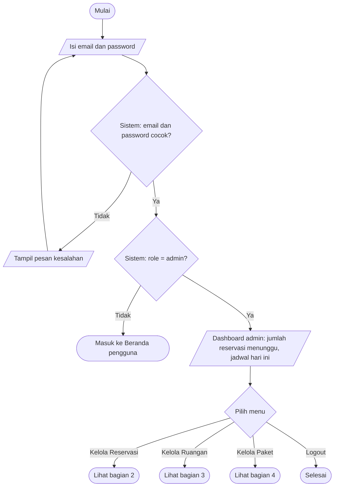
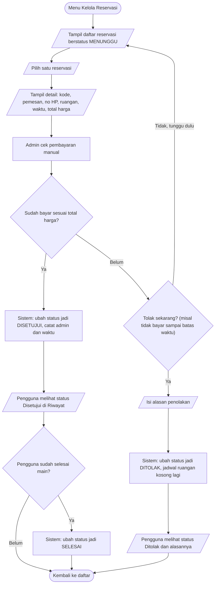
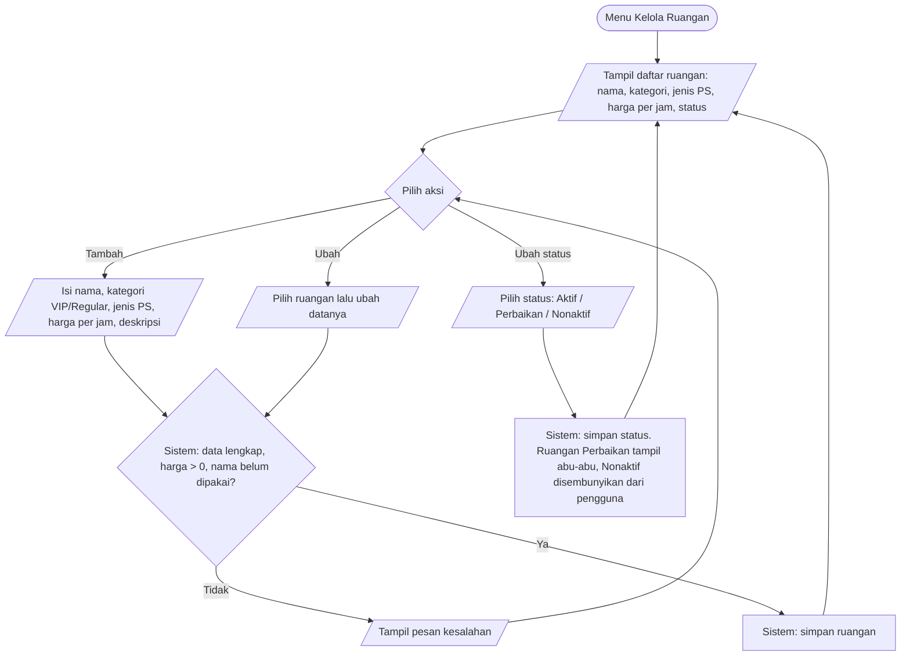
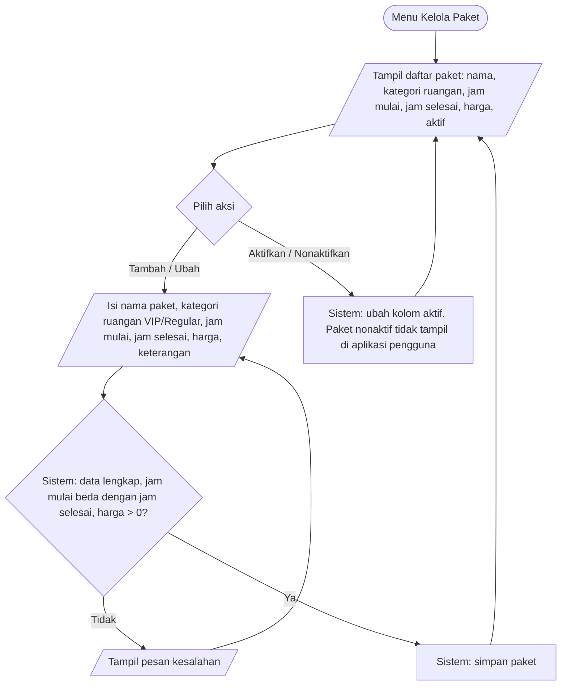

# Flowchart Admin

Alur dari sisi admin (pemilik / penjaga rental). Simbol sama seperti di [flowchart-pengguna.md](flowchart-pengguna.md):
oval = mulai/selesai, kotak = langkah, belah ketupat = keputusan, jajaran genjang = input/output.

---

## 1. Login dan Menu Utama

Admin memakai halaman login yang sama dengan pengguna. Sistem melihat kolom `role` di tabel `users` untuk menentukan halaman mana yang dibuka.

## 2. Kelola Reservasi (Persetujuan Pembayaran)

Pembayaran dilakukan **di luar aplikasi** (bayar di tempat atau transfer). Admin mengecek sendiri apakah uang sudah diterima, lalu menyetujui atau menolak di aplikasi.

## 3. Kelola Ruangan

Setiap ruangan hanya berisi **satu jenis PS**.

Ruangan **tidak dihapus** dari database supaya riwayat reservasi lama tetap lengkap. Sebagai gantinya, admin mengubah statusnya menjadi *Nonaktif*.

## 4. Kelola Paket

Paket = sewa ruangan dengan jam dan harga yang sudah ditentukan (misal Paket Malam 22:00 sampai 06:00, Paket Pelajar 13:00 sampai 17:00).

