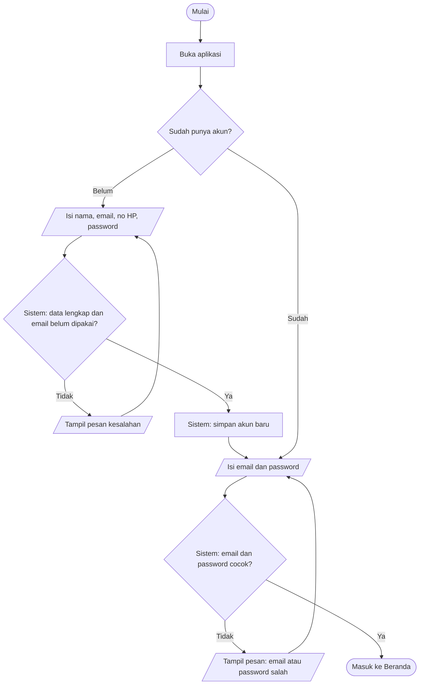
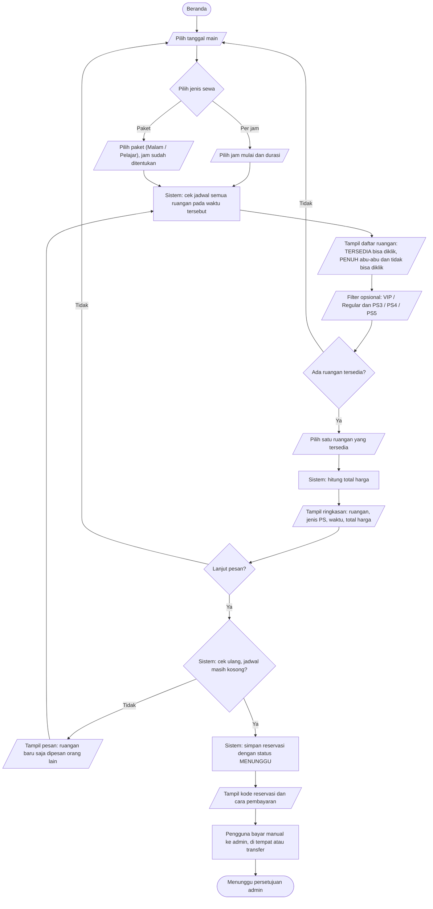
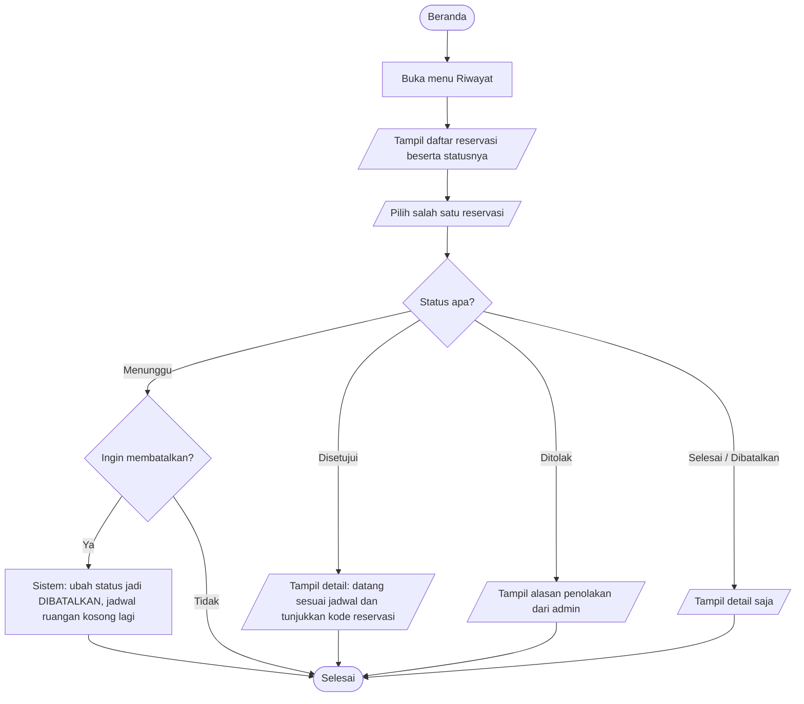

# Flowchart Pengguna

Alur dari sisi pengguna (pelanggan rental). Diagram ditulis dengan **Mermaid**, jadi otomatis tampil sebagai gambar di GitHub. Kalau ingin digambar ulang di Figma atau draw.io, ikuti kotak dan panahnya saja.

**Cara baca simbol:**

| Bentuk | Arti |
|---|---|
| Oval `([ ])` | Mulai / Selesai |
| Kotak `[ ]` | Langkah yang dilakukan pengguna atau sistem |
| Belah ketupat `{ }` | Keputusan / pengecekan (jawabannya Ya atau Tidak) |
| Jajaran genjang `[/ /]` | Input dari pengguna atau output yang ditampilkan |

Kotak berawalan **Sistem:** dikerjakan oleh aplikasi/backend, bukan oleh pengguna.

---

## 1. Daftar dan Login

## 2. Membuat Reservasi

Ini alur utama aplikasi.

**Cara sistem menghitung harga:**

- **Per jam:** `durasi (jam) x harga per jam ruangan`. Contoh: 2 jam di VIP 2 (Rp25.000/jam) = Rp50.000.
- **Paket:** harga tetap sesuai paket, tidak dikali jam. Contoh: Paket Malam VIP = Rp100.000.

**Kapan ruangan dianggap PENUH:** jika ada reservasi lain di ruangan itu yang statusnya *Menunggu* atau *Disetujui* dan waktunya bertabrakan dengan waktu yang dipilih. Ruangan yang sedang *perbaikan* juga tampil abu-abu.

## 3. Riwayat dan Status Reservasi

Pengguna hanya bisa membatalkan selama status masih **Menunggu**. Setelah disetujui admin, pembatalan harus lewat admin (dibahas lagi nanti kalau dibutuhkan).
