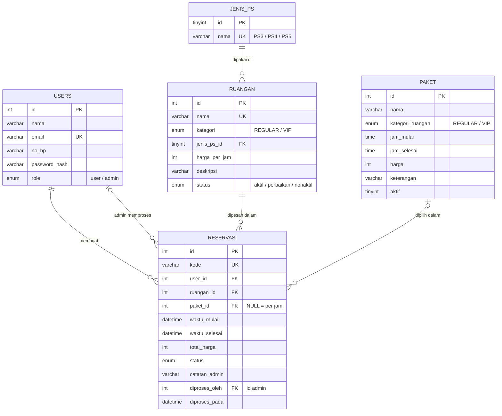
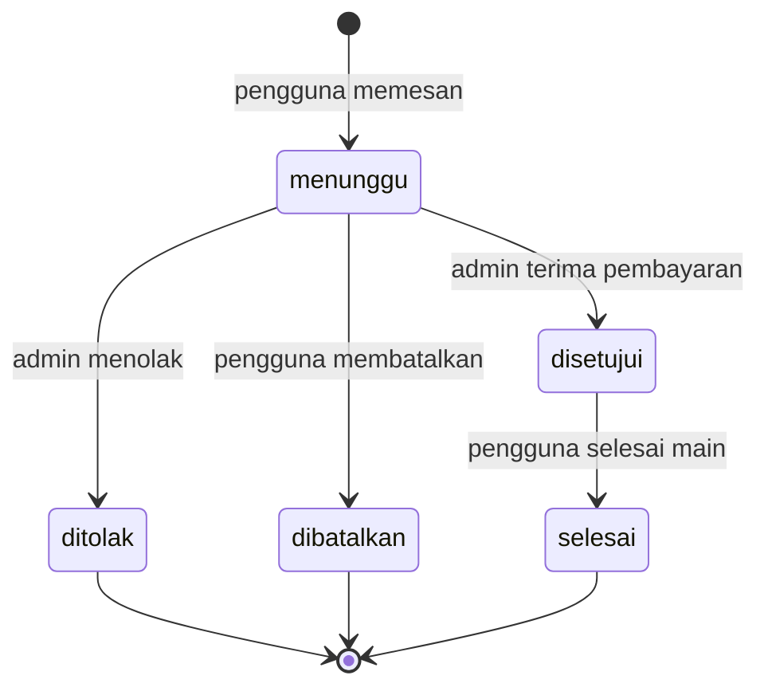

# Rancangan Database (MySQL)

Nama database: `rental_ps`. File SQL siap pakai ada di folder [`database/`](../database):

| File | Isi |
|---|---|
| [`schema.sql`](../database/schema.sql) | Membuat database dan 5 tabel |
| [`seed.sql`](../database/seed.sql) | Data contoh (akun, PS, ruangan, paket, reservasi) |
| [`contoh_query.sql`](../database/contoh_query.sql) | Contoh query: cek ruangan penuh, hitung harga, simpan reservasi, persetujuan admin |

**Cara mencoba di Beekeeper Studio:** buka koneksi MySQL, buka `schema.sql` lalu jalankan semua (Run All), kemudian `seed.sql`, kemudian coba query di `contoh_query.sql` satu per satu.

---

## ERD (Entity Relationship Diagram)



**Cara baca relasi:**
- Satu **pengguna** bisa punya banyak **reservasi** (1 ke banyak).
- Satu **jenis PS** bisa dipakai di banyak **ruangan**, tapi satu ruangan hanya punya **satu** jenis PS.
- Satu **ruangan** bisa dipesan berkali-kali (di jam yang berbeda).
- Satu **paket** bisa dipakai banyak reservasi. Reservasi per jam tidak memakai paket (`paket_id` kosong / NULL).
- Admin juga disimpan di tabel `users`. Kolom `diproses_oleh` mencatat admin mana yang menyetujui atau menolak.

---

## Penjelasan Tabel

Semua tabel juga punya kolom `created_at` dan `updated_at` (diisi otomatis oleh MySQL).

### 1. `users`
Menyimpan semua akun, baik pengguna maupun admin.

| Kolom | Tipe | Keterangan |
|---|---|---|
| id | INT, PK | Nomor unik otomatis |
| nama | VARCHAR(100) | Nama lengkap |
| email | VARCHAR(100), unik | Dipakai untuk login, tidak boleh sama |
| no_hp | VARCHAR(20) | Untuk dihubungi admin soal pembayaran |
| password_hash | VARCHAR(255) | Password yang sudah di-hash (bcrypt). **Jangan simpan password asli.** |
| role | ENUM('user','admin') | Menentukan halaman yang dibuka setelah login |

### 2. `jenis_ps`
Daftar konsol: PS3, PS4, PS5. Dibuat tabel sendiri supaya kalau nanti ada jenis baru (misal PS5 Pro) cukup tambah satu baris.

### 3. `ruangan`

| Kolom | Tipe | Keterangan |
|---|---|---|
| id | INT, PK | |
| nama | VARCHAR(50), unik | Contoh: "VIP 1", "Regular 3" |
| kategori | ENUM('REGULAR','VIP') | |
| jenis_ps_id | FK ke `jenis_ps` | **Satu ruangan = satu jenis PS** |
| harga_per_jam | INT | Dalam Rupiah. Dipakai untuk sewa per jam |
| deskripsi | VARCHAR(255) | Fasilitas, contoh "TV 55 inch, sofa, AC" |
| status | ENUM('aktif','perbaikan','nonaktif') | Kondisi ruangan, **bukan** penuh/tidaknya |

> **Penting:** "Penuh" tidak disimpan sebagai kolom. Penuh atau tidaknya ruangan tergantung jam yang dipilih pengguna, jadi selalu dihitung dari tabel `reservasi` (lihat query nomor 1 di `contoh_query.sql`).

### 4. `paket`

| Kolom | Tipe | Keterangan |
|---|---|---|
| id | INT, PK | |
| nama | VARCHAR(50) | Contoh: "Paket Malam", "Paket Pelajar" |
| kategori_ruangan | ENUM('REGULAR','VIP') | Paket ini berlaku untuk ruangan kategori apa |
| jam_mulai, jam_selesai | TIME | Jam yang sudah ditentukan. Kalau jam_selesai lebih kecil dari jam_mulai (22:00 sampai 06:00), artinya selesai besok paginya |
| harga | INT | Harga total paket, tidak dikali jam |
| keterangan | VARCHAR(255) | Contoh: "Tunjukkan kartu pelajar saat datang" |
| aktif | TINYINT(1) | 1 = tampil di aplikasi, 0 = disembunyikan |

Paket Malam untuk VIP dan untuk Regular disimpan sebagai **dua baris** karena harganya berbeda.

### 5. `reservasi`

| Kolom | Tipe | Keterangan |
|---|---|---|
| id | INT, PK | |
| kode | VARCHAR(20), unik | Contoh "RSV-20261123-0001", ditunjukkan ke admin saat bayar |
| user_id | FK ke `users` | Siapa yang memesan |
| ruangan_id | FK ke `ruangan` | Ruangan yang dipesan |
| paket_id | FK ke `paket`, boleh NULL | NULL berarti sewa per jam |
| waktu_mulai, waktu_selesai | DATETIME | Tanggal + jam. Memakai DATETIME supaya paket malam yang lewat tengah malam tetap bisa disimpan |
| total_harga | INT | Disimpan saat memesan, supaya riwayat tidak ikut berubah kalau admin mengganti harga |
| status | ENUM | Lihat alur status di bawah |
| catatan_admin | VARCHAR(255) | Contoh: alasan ditolak |
| diproses_oleh | FK ke `users` | Admin yang menyetujui / menolak |
| diproses_pada | DATETIME | Kapan disetujui / ditolak |

---

## Alur Status Reservasi



Status **menunggu** dan **disetujui** dianggap "mengisi" jadwal ruangan. Jadi begitu pengguna memesan, ruangan itu langsung tampil PENUH untuk orang lain di jam yang sama. Kalau ditolak atau dibatalkan, jadwalnya otomatis kosong lagi.

## Cara Mengecek Jadwal Bentrok

Dua jadwal dianggap **bertabrakan** jika:

```
jadwal_lama.waktu_mulai < jadwal_baru.waktu_selesai
DAN
jadwal_lama.waktu_selesai > jadwal_baru.waktu_mulai
```

Contoh: sudah ada pesanan 14:00 sampai 16:00. Pesanan baru 15:00 sampai 17:00 bentrok (14:00 < 17:00 dan 16:00 > 15:00). Pesanan baru 16:00 sampai 18:00 **tidak** bentrok karena 16:00 > 16:00 salah.

---

## Cara Menambah Fitur Nanti

Rancangan ini dibuat supaya mudah ditambah. Beberapa contoh:

| Fitur baru | Perubahan database |
|---|---|
| Upload bukti transfer | Tambah kolom `bukti_bayar VARCHAR(255)` di `reservasi` (menyimpan nama file gambar) |
| Batas waktu bayar otomatis | Tambah kolom `batas_bayar DATETIME` di `reservasi` |
| Jam buka rental | Tabel baru `pengaturan` (jam_buka, jam_tutup) |
| Paket hanya hari tertentu | Tambah kolom `hari_berlaku` di `paket` |
| Harga paket beda per jenis PS | Tambah kolom `jenis_ps_id` (boleh NULL) di `paket` |
| Ulasan / rating | Tabel baru `ulasan` dengan FK ke `reservasi` |
